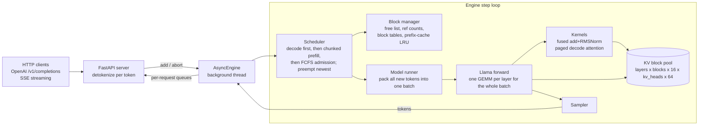

# tiny-infer

A from-scratch LLM inference server: an iteration-level **continuous batching** scheduler, a **paged KV cache** with prefix caching, an OpenAI-compatible **streaming** API, and my own **CUDA kernels** from [cuda-kernel-lab](https://github.com/Musharaf-khan/cuda-kernel-lab) in the decode path. It is benchmarked with one harness against HuggingFace `generate()` and against vLLM.

**The chain:** [cuda-kernel-lab](https://github.com/Musharaf-khan/cuda-kernel-lab) produced kernels that beat PyTorch ops in isolation. tiny-infer puts them inside a serving engine and measures what they change end to end, in tokens per second.

**Model:** TinyLlama-1.1B-Chat, FP16. **GPU:** one NVIDIA T4 (Turing, sm_75, 320 GB/s, 15 GiB). **Code:** about 1,500 lines of engine Python and 480 lines of CUDA/C++, plus 1,600 lines of benchmarks and tests. **Correctness:** greedy output is token-identical to HuggingFace's. This is checked on every code path, including the ones that preempt and recompute.

---

## Results (T4, FP16)

> **Status:** the numbers below come from running [`notebooks/t4_runbook.ipynb`](notebooks/t4_runbook.ipynb) top to bottom on a Colab T4. That run generates [`results/REPORT.md`](results/REPORT.md); its tables are pasted here unedited. Cells showing `—` are still waiting for a measured value. Nothing in this README is estimated.

### Serving comparison (same workload, same client, same GPU)

| System | Concurrency | Output tok/s | p50 TTFT | p99 TTFT | p50 TPOT | Peak running seqs |
|---|---:|---:|---:|---:|---:|---:|
| HF `generate()` (baseline) | 1 | — | — | — | — | 1 |
| Naive server (one `generate()` at a time) | 1 / 4 / 16 | — | — | — | — | 1 |
| tiny-infer (batched + paged) | 1 / 4 / 16 / 32 / 64 | — | — | — | — | — |
| tiny-infer + Project 1 kernels | 1 / 4 / 16 / 32 / 64 | — | — | — | — | — |
| vLLM (official) | 1 / 4 / 16 / 32 / 64 | — | — | — | — | — |

Throughput, TTFT and TPOT vs concurrency are plotted to `results/serving.png` by the same run.

### Paged vs contiguous KV cache (1 GiB pool, same kernels)

| Allocation | Peak concurrent sequences | Mean KV waste | Output tok/s |
|---|---:|---:|---:|
| contiguous (reserve `max_model_len`) | — | — | — |
| paged (16-token blocks, on demand) | — | — | — |

Closed form for this workload: a 1 GiB pool holds 47,648 token slots at 22,528 B/token. Contiguous reservation of 2,048 tokens fits **23** sequences. Paged allocation at the workload's mean final length of about 480 tokens fits about **96**. The measured numbers above test that prediction.

### Project 1 kernels in the decode path

| Kernel | Replaces | Op speedup | Decode-step (TPOT) speedup @ batch 32 |
|---|---|---:|---:|
| fused residual-add + RMSNorm (FP16) | `x + residual` then HF `LlamaRMSNorm` (a chain of ~8 small kernels) | — | — |
| GQA paged decode attention (split-K) | gather-from-blocks + `repeat_interleave` + SDPA | — | — |

Write-up: [docs/kernels.md](docs/kernels.md). Gap to vLLM, with a profiler breakdown: [docs/vllm_gap.md](docs/vllm_gap.md).

---

## Architecture



**One rule drives everything.** Each sequence has `token_ids` (prompt plus generated tokens) and `num_computed_tokens` (how many of those already have K/V in the cache). Every step processes the uncomputed suffix, up to the token budget. When a step reaches the end of `token_ids`, one token is sampled. Each feature is a special case of that rule:

| Feature | In terms of the rule |
|---|---|
| decode | 1 new token |
| prefill | the whole prompt |
| chunked prefill | several partial steps |
| prefix-cache hit | `num_computed_tokens` starts above 0 |
| preemption | `num_computed_tokens` is reset to 0 and the sequence is recomputed |

They all share one code path and are all checked by the same oracle.

```text
loop forever:                                       # tiny_infer/scheduler.py
    decode:  for each running seq (oldest first): reserve a slot for its next token;
             if the pool is full, preempt the NEWEST seq (free its blocks, requeue it at the front)
    prefill: continue partially-prefilled seqs with the remaining token budget
    admit:   while the pool can hold the next waiting prompt (minus prefix hits): admit it (FCFS)
    run ONE forward pass over all scheduled tokens; sample; append; retire finished seqs at once
```

Design notes, with every decision and the reason for it: [docs/design.md](docs/design.md).

## Quickstart

**Colab (T4, no setup):** open [`notebooks/t4_runbook.ipynb`](notebooks/t4_runbook.ipynb) in Colab, pick the T4 runtime, then choose Run all.

**Any CUDA machine:**

```bash
git clone https://github.com/Musharaf-khan/tiny-infer && cd tiny-infer
pip install -r requirements.txt                      # torch with CUDA assumed
python -m tiny_infer.server --custom-kernels         # :8000, OpenAI-compatible
curl -N localhost:8000/v1/completions -H 'content-type: application/json' \
  -d '{"prompt": "<|user|>\nWhat is a KV cache?</s>\n<|assistant|>\n", "max_tokens": 128, "stream": true}'
python scripts/demo.py --users 8                     # live multi-user streaming view
```

**Docker:** `docker build -t tiny-infer . && docker run --gpus all -p 8000:8000 tiny-infer`

**Offline API:**

```python
from tiny_infer import EngineConfig, LLMEngine, SamplingParams
eng = LLMEngine(EngineConfig(use_custom_kernels=True))
for s in eng.generate(["The capital of France is"] * 4, SamplingParams(max_tokens=32, temperature=0)):
    print(eng.tokenizer.decode(s.output_ids))
```

Useful server flags:

| Flag | Effect |
|---|---|
| `--kv-mode contiguous` | the "before" allocator |
| `--kv-cache-gb 1` | fixed KV pool |
| `--prefix-caching` | turn on prefix caching |
| `--no-chunked-prefill` | turn off chunked prefill |
| `--max-num-batched-tokens 512` | set the per-step token budget |
| `--backend naive` | run the Phase 2 server |

## Benchmarks: how each number is produced

| Script | Measures |
|---|---|
| `bench/harness.py` | Any OpenAI endpoint: TTFT, TPOT, ITL, E2E (p50 and p99), output and input tok/s reported separately, req/s, error rate, GPU utilisation. Prompts are sent as token IDs with `ignore_eos`, so every system does identical work. |
| `bench/hf_baseline.py` | HF `generate()` at concurrency 1 (TTFT, TPOT, peak VRAM), plus padded static batching |
| `bench/kv_capacity.py` | paged vs contiguous on the same fixed pool: peak concurrency, KV waste, preemptions, throughput |
| `bench/kernel_bench.py` | each kernel vs the PyTorch path it replaces (µs, GB/s against 320 GB/s), plus end-to-end decode-step delta |
| `bench/step_profile.py` | torch.profiler breakdown of one decode step: GEMM, attention, norm, copies, idle GPU (CPU overhead), and the roofline floor |
| `scripts/check_correctness.py` | real-model oracle against HF: fp32 must be identical; in fp16 every divergence is reported with its top-2 logit gap |
| `bench/make_report.py` | `results/*.json` → `results/REPORT.md` and charts |

## Tests

```bash
python -m pytest tests -q      # 26 tests, CPU, ~15 s
```

The tests build a small random Llama (GQA, RoPE, RMSNorm, SwiGLU) and require **token-identical** greedy output against HF `generate()` under all of these configurations:

- batched and paged
- unfused weights
- no chunking
- a 7-token budget (many chunks)
- contiguous allocation
- one sequence at a time
- 16-token blocks
- forced recompute-preemption
- prefix-cache hits

The other tests cover block-manager invariants and scheduler policy, plus real HTTP/SSE streaming with concurrent clients. The CUDA kernels self-test against the PyTorch reference every time the engine starts with `--custom-kernels`. The engine refuses to serve if any kernel disagrees.

## Honest scope

This is a single-GPU engine with Python-level scheduling.

**Not included:**
- tensor or pipeline parallelism
- disaggregated prefill/decode
- CUDA graphs
- speculative decoding
- quantisation
- production hardening such as autoscaling or fault tolerance

**Not supported:**
- copy-on-write forking, because nothing forks. Only full blocks are shared, so a shared block is never written. CoW would be needed for parallel sampling and beam search; it's explained in [docs/design.md](docs/design.md).

**The vLLM gap is the expected result, not a surprise.** The reasons are measured in [docs/vllm_gap.md](docs/vllm_gap.md).

## Layout

```text
tiny_infer/
  config.py          ModelConfig (+ KV math), EngineConfig
  sequence.py        Sequence, SamplingParams: the token_ids / num_computed_tokens rule
  block_manager.py   paged + contiguous allocation, ref counts, prefix cache (hash chain + LRU)
  scheduler.py       iteration-level scheduler: decode-first, chunked prefill, preemption
  model.py           Llama forward over a packed batch; paged KV writes; prefill/decode attention split
  ops.py             reference ops (HF-exact) + dispatch to the CUDA custom ops
  kernels.py         JIT build + self-test of the CUDA extension
  csrc/              rms_norm.cu, paged_attention.cu, reduce.cuh, ops.cpp (TORCH_LIBRARY registration)
  engine.py          LLMEngine.step(): schedule → prepare → forward → sample → retire
  async_engine.py    engine loop thread ↔ asyncio streams
  server.py          OpenAI /v1/completions (+SSE), naive HF backend for Phase 2
bench/  scripts/  tests/  notebooks/t4_runbook.ipynb  docs/
```

## References

The design draws on the following work:

- Kwon et al., *Efficient Memory Management for LLM Serving with PagedAttention* (SOSP '23)
- Yu et al., *Orca* (OSDI '22), which introduced iteration-level scheduling
- Dao et al., *Flash-Decoding*

Structure was also cross-checked against several open-source engines (code was read and compared, not copied):

- nano-vllm
- ember
- neel429/llm-inference-engine
