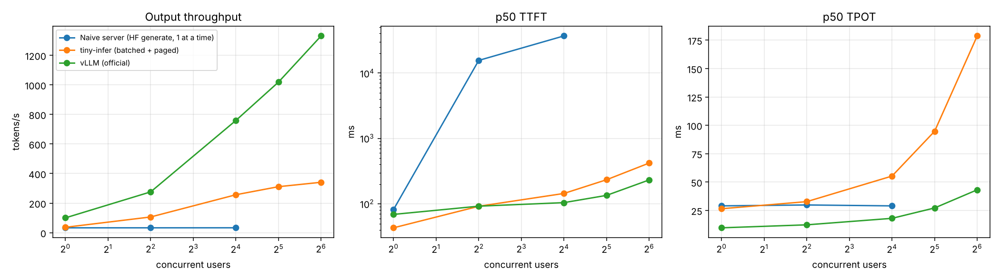
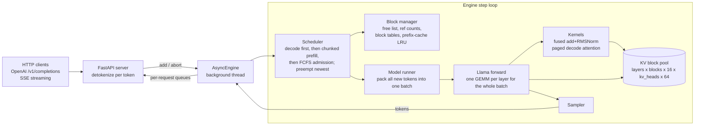

# tiny-infer

A from-scratch LLM inference server: an iteration-level **continuous batching** scheduler, a **paged KV cache** with prefix caching, an OpenAI-compatible **streaming** API, and my own **CUDA kernels** from [cuda-kernel-lab](https://github.com/Musharaf-khan/cuda-kernel-lab) in the decode path. It is benchmarked with one harness against HuggingFace `generate()` and against vLLM.

**The chain:** [cuda-kernel-lab](https://github.com/Musharaf-khan/cuda-kernel-lab) produced kernels that beat PyTorch ops in isolation. tiny-infer puts them inside a serving engine and measures what they change end to end, in tokens per second.

**Model:** TinyLlama-1.1B-Chat, FP16. **GPU:** one NVIDIA T4 (Turing, sm_75, 320 GB/s, 15 GiB). **Code:** about 1,500 lines of engine Python and 480 lines of CUDA/C++, plus 1,600 lines of benchmarks and tests. **Correctness:** greedy output is token-identical to HuggingFace's in the test suite, on every code path, including the ones that preempt and recompute.

---

## Results (Tesla T4, FP16, measured)

All numbers come from [`notebooks/t4_runbook.ipynb`](notebooks/t4_runbook.ipynb) on a Colab T4. Raw data and the auto-generated report are in [`results/`](results/REPORT.md).

**Workload:** prompts of 128–512 tokens and outputs of 64–256 tokens. Prompts are sent as token IDs with `ignore_eos`, so every system generates the same tokens. The client runs a closed loop at fixed concurrency and times everything over HTTP/SSE.

### Serving comparison (same workload, same client, same GPU)

| System | Concurrency | Output tok/s | p50 TTFT | p99 TTFT | p50 TPOT | GPU util |
|---|---:|---:|---:|---:|---:|---:|
| HF `generate()` in-process (baseline) | 1 | 35.6 | 76 ms | – | 28.1 ms | – |
| HF static batching (padded, offline) | 16 / 32 | 230.5 / 253.7 | – | – | – | – |
| Naive server (one `generate()` at a time) | 1 | 32.9 | 82 ms | 112 ms | 29.0 ms | 47% |
| | 4 | 32.9 | **15.5 s** | 18.3 s | 29.8 ms | 47% |
| | 16 | 33.1 | **36.7 s** | **77.0 s** | 29.0 ms | 47% |
| **tiny-infer** (continuous batching + paged KV) | 1 | 36.4 | 43 ms | 54 ms | 26.5 ms | 47% |
| | 4 | 106.3 | 92 ms | 213 ms | 32.7 ms | 58% |
| | 16 | 256.6 | 144 ms | 837 ms | 55.2 ms | 77% |
| | 32 | 311.2 | 234 ms | 1.58 s | 94.7 ms | 83% |
| | 64 | 340.9 | 420 ms | 3.27 s | 178.8 ms | 87% |
| tiny-infer + Project 1 kernels | 1–64 | *rerun pending* | | | | |
| **vLLM 0.31.0** (`--dtype half`, prefix caching off) | 1 | 100.3 | 69 ms | 92 ms | 9.6 ms | 99% |
| | 4 | 276.0 | 92 ms | 216 ms | 12.3 ms | 98% |
| | 16 | 759.2 | 104 ms | 825 ms | 18.0 ms | 99% |
| | 32 | 1,018.9 | 135 ms | 1.46 s | 27.1 ms | 99% |
| | 64 | 1,331.1 | 232 ms | 2.95 s | 43.1 ms | 99% |

**What the table shows:**

- **Continuous batching vs the naive server.**
  - The naive server's throughput is flat at about 33 tok/s whatever the load. Its TTFT grows with queue depth instead, reaching a p99 of 77 s at 16 users. That is the Phase 2 collapse.
  - tiny-infer serves the same load at **3.2x the naive server's throughput at 4 users and 7.75x at 16 users**, with p50 TTFT staying under 150 ms.
  - Against an idealised HF static batch, where all requests arrive together and run offline, tiny-infer is **1.11x faster at 16 users and 1.23x at 32**. It also streams, and admits new requests every step instead of every batch.
- **vs vLLM: tiny-infer reaches 26–38% of vLLM's throughput** (36% at 1 user, 34% at 16, 26% at 64).
  - The gap is mostly in TPOT, which grows from 26 to 179 ms in tiny-infer but only from 10 to 43 ms in vLLM.
  - The profile below shows why, and [docs/vllm_gap.md](docs/vllm_gap.md) breaks it down.



### Paged vs contiguous KV cache (1 GiB pool, same kernels, 256 requests submitted at once)

| Allocation | Peak concurrent sequences | Mean KV waste | Preemptions | Output tok/s |
|---|---:|---:|---:|---:|
| contiguous (reserve `max_model_len` = 2,048) | 23 | 79.7% | 0 | 314.9 |
| **paged** (16-token blocks, on demand) | **143** | **1.5%** | 21 | **381.5** |

**Paging fit 6.2x more sequences in the same memory and cut KV waste from 79.7% to 1.5%.** The vLLM paper reports going from 60–80% waste to under 4%.

The closed form predicted 23 sequences for contiguous allocation, which matched exactly. For paged allocation it predicted about 96 at the mean *final* length. Paged peaked higher, at 143, because sequences early in their output are still short. Being that optimistic is what causes the 21 recompute preemptions.

### Differentiators: prefix caching and chunked prefill (16 users)

| Run | p50 TTFT | p99 TTFT | p99 ITL | Output tok/s |
|---|---:|---:|---:|---:|
| 1,024-token shared system prompt, prefix caching **off** | 376 ms | 2,714 ms | 304 ms | 120.4 |
| same, prefix caching **on** (84% of prompt tokens hit) | **209 ms** | **707 ms** | **130 ms** | **170.5** |
| prompts of 64–1,900 tokens, no chunking | 363 ms | 2,673 ms | 303 ms | 123.8 |
| same, chunked prefill (512-token budget) | 691 ms | 4,036 ms | **169 ms** | 122.6 |

- **Prefix caching:** 3.8x lower p99 TTFT, 1.8x lower p50 TTFT, and 1.42x the throughput.
- **Chunked prefill is a trade-off.** It cut the p99 inter-token latency of running streams by 44%, because no decode waits behind a 1,900-token prefill. But it raised TTFT, because a 512-token budget spreads every long prompt over several steps. In other words, it protects users who are already streaming at the expense of newcomers. That is the reason vLLM tunes the budget instead of fixing it.

### Where a decode step goes (batch 32, `torch.profiler`)

| Wall time | GPU busy | GPU idle (CPU-side) | Copy / gather | GEMM-class | Roofline floor |
|---:|---:|---:|---:|---:|---:|
| 79.5 ms | 65.7 ms | 13.8 ms | **31.6 ms** | 31.2 ms | 7.7 ms |

**Half of the GPU time is spent copying K/V.** The PyTorch decode-attention path gathers each sequence's K/V out of the block pool and `repeat_interleave`s it 8x for GQA before SDPA. That is exactly the traffic the Project 1 paged-attention kernel removes. The GEMM-class bucket also includes SDPA's batched matmuls, because sm_75 falls back to the math path.

### Project 1 kernels in the decode path

| Kernel | Replaces | Op speedup | Decode-step (TPOT) speedup @ batch 32 |
|---|---|---:|---:|
| fused residual-add + RMSNorm (FP16) | `x + residual` then HF `LlamaRMSNorm` (a chain of ~8 small kernels) | *rerun pending* | *rerun pending* |
| GQA paged decode attention (split-K) | gather-from-blocks + `repeat_interleave` + SDPA | *rerun pending* | *rerun pending* |

The first T4 run did not produce kernel numbers. A bug in the kernel **self-test harness** (its block pool was smaller than its block tables) stopped the engine at startup. The fix is in, and a regression test now covers it. [`notebooks/t4_kernels_rerun.ipynb`](notebooks/t4_kernels_rerun.ipynb) re-runs only the kernel steps.

Write-up: [docs/kernels.md](docs/kernels.md). Gap to vLLM, with a profiler breakdown: [docs/vllm_gap.md](docs/vllm_gap.md).

---

## Architecture



**One rule drives everything.** Each sequence has `token_ids` (prompt plus generated tokens) and `num_computed_tokens` (how many of those already have K/V in the cache). Every step processes the uncomputed suffix, up to the token budget. When a step reaches the end of `token_ids`, one token is sampled. Each feature is a special case of that rule:

| Feature | In terms of the rule |
|---|---|
| decode | 1 new token |
| prefill | the whole prompt |
| chunked prefill | several partial steps |
| prefix-cache hit | `num_computed_tokens` starts above 0 |
| preemption | `num_computed_tokens` is reset to 0 and the sequence is recomputed |

They all share one code path and are all checked by the same oracle.

```text
loop forever:                                       # tiny_infer/scheduler.py
    decode:  for each running seq (oldest first): reserve a slot for its next token;
             if the pool is full, preempt the NEWEST seq (free its blocks, requeue it at the front)
    prefill: continue partially-prefilled seqs with the remaining token budget
    admit:   while the pool can hold the next waiting prompt (minus prefix hits): admit it (FCFS)
    run ONE forward pass over all scheduled tokens; sample; append; retire finished seqs at once
```

Design notes, with every decision and the reason for it: [docs/design.md](docs/design.md).

## Quickstart

**Colab (T4, no setup):** open [`notebooks/t4_runbook.ipynb`](notebooks/t4_runbook.ipynb) in Colab, pick the T4 runtime, then choose Run all.

**Any CUDA machine:**

```bash
git clone https://github.com/Musharaf-khan/tiny-infer && cd tiny-infer
pip install -r requirements.txt                      # torch with CUDA assumed
python -m tiny_infer.server --custom-kernels         # :8000, OpenAI-compatible
curl -N localhost:8000/v1/completions -H 'content-type: application/json' \
  -d '{"prompt": "<|user|>\nWhat is a KV cache?</s>\n<|assistant|>\n", "max_tokens": 128, "stream": true}'
python scripts/demo.py --users 8                     # live multi-user streaming view
```

**Docker:** `docker build -t tiny-infer . && docker run --gpus all -p 8000:8000 tiny-infer`

**Offline API:**

```python
from tiny_infer import EngineConfig, LLMEngine, SamplingParams
eng = LLMEngine(EngineConfig(use_custom_kernels=True))
for s in eng.generate(["The capital of France is"] * 4, SamplingParams(max_tokens=32, temperature=0)):
    print(eng.tokenizer.decode(s.output_ids))
```

Useful server flags:

| Flag | Effect |
|---|---|
| `--kv-mode contiguous` | the "before" allocator |
| `--kv-cache-gb 1` | fixed KV pool |
| `--prefix-caching` | turn on prefix caching |
| `--no-chunked-prefill` | turn off chunked prefill |
| `--max-num-batched-tokens 512` | set the per-step token budget |
| `--backend naive` | run the Phase 2 server |

## Benchmarks: how each number is produced

| Script | Measures |
|---|---|
| `bench/harness.py` | Any OpenAI endpoint: TTFT, TPOT, ITL, E2E (p50 and p99), output and input tok/s reported separately, req/s, error rate, GPU utilisation. Prompts are sent as token IDs with `ignore_eos`, so every system does identical work. |
| `bench/hf_baseline.py` | HF `generate()` at concurrency 1 (TTFT, TPOT, peak VRAM), plus padded static batching |
| `bench/kv_capacity.py` | paged vs contiguous on the same fixed pool: peak concurrency, KV waste, preemptions, throughput |
| `bench/kernel_bench.py` | each kernel vs the PyTorch path it replaces (µs, GB/s against 320 GB/s), plus end-to-end decode-step delta |
| `bench/step_profile.py` | torch.profiler breakdown of one decode step: GEMM, attention, norm, copies, idle GPU (CPU overhead), and the roofline floor |
| `scripts/check_correctness.py` | real-model oracle against HF: fp32 must be identical; in fp16 every divergence is reported with its top-2 logit gap |
| `bench/make_report.py` | `results/*.json` → `results/REPORT.md` and charts |

## Tests

```bash
python -m pytest tests -q      # 28 tests, CPU, ~30 s
```

The tests build a small random Llama (GQA, RoPE, RMSNorm, SwiGLU) and require **token-identical** greedy output against HF `generate()` under all of these configurations:

- batched and paged
- unfused weights
- no chunking
- a 7-token budget (many chunks)
- contiguous allocation
- one sequence at a time
- 16-token blocks
- forced recompute-preemption
- prefix-cache hits

The other tests cover block-manager invariants and scheduler policy, plus real HTTP/SSE streaming with concurrent clients. The CUDA kernels self-test against the PyTorch reference every time the engine starts with `--custom-kernels`. The engine refuses to serve if any kernel disagrees.

## Honest scope

This is a single-GPU engine with Python-level scheduling.

**Not included:**
- tensor or pipeline parallelism
- disaggregated prefill/decode
- CUDA graphs
- speculative decoding
- quantisation
- production hardening such as autoscaling or fault tolerance

**Not supported:**
- copy-on-write forking, because nothing forks. Only full blocks are shared, so a shared block is never written. CoW would be needed for parallel sampling and beam search; it's explained in [docs/design.md](docs/design.md).

**The vLLM gap is the expected result, not a surprise.** The reasons are measured in [docs/vllm_gap.md](docs/vllm_gap.md).

## Layout

```text
tiny_infer/
  config.py          ModelConfig (+ KV math), EngineConfig
  sequence.py        Sequence, SamplingParams: the token_ids / num_computed_tokens rule
  block_manager.py   paged + contiguous allocation, ref counts, prefix cache (hash chain + LRU)
  scheduler.py       iteration-level scheduler: decode-first, chunked prefill, preemption
  model.py           Llama forward over a packed batch; paged KV writes; prefill/decode attention split
  ops.py             reference ops (HF-exact) + dispatch to the CUDA custom ops
  kernels.py         JIT build + self-test of the CUDA extension
  csrc/              rms_norm.cu, paged_attention.cu, reduce.cuh, ops.cpp (TORCH_LIBRARY registration)
  engine.py          LLMEngine.step(): schedule → prepare → forward → sample → retire
  async_engine.py    engine loop thread ↔ asyncio streams
  server.py          OpenAI /v1/completions (+SSE), naive HF backend for Phase 2
bench/  scripts/  tests/  notebooks/t4_runbook.ipynb  docs/
```

## References

The design draws on the following work:

- Kwon et al., *Efficient Memory Management for LLM Serving with PagedAttention* (SOSP '23)
- Yu et al., *Orca* (OSDI '22), which introduced iteration-level scheduling
- Dao et al., *Flash-Decoding*

Structure was also cross-checked against several open-source engines (code was read and compared, not copied):

- nano-vllm
- ember
- neel429/llm-inference-engine
